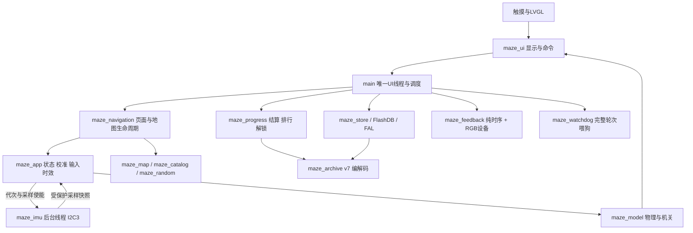
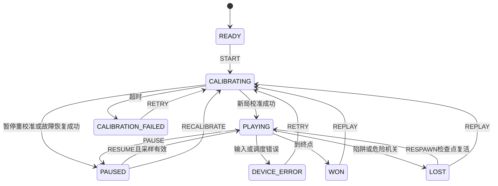

# 方案设计（最终实现）

本设计对应src现状，初版方案和历次取舍见[历史架构](../superpowers/specs/2026-10-17-maze-architecture-design.md)。只有main/UI线程操作LVGL；IMU线程发布受保护快照。

## 系统架构

## 数据流与时间

IMU通过I2C3访问0x6a，发布加速度raw三轴等字段；应用工作循环每次读后请求等待50ms，不把硬件ODR104Hz等同应用104Hz。校准窗口、死区和时效由config维护。物理常规10ms步；动态碰撞采用更细步进以防穿过移动机关。真实服务/显示时间仍须区分请求周期与板端测量。

main在等待LCD提交时仅推进采样/导航纯逻辑，不做LVGL重入、存储、随机生成或RGB硬件I/O，也不喂狗。只有完整主循环返回才证明主循环有进展。已识别的设备异常仍显示可操作错误页；传感器错误不是立即重启的理由。

## 状态机

图中复活事件对应实际MAZE_EVENT_RESPAWN。页面层另有MAZE_NAV_SELECT/GAME/SCORES/GENERATING和错误页；返回/取消/换图由navigation结束旧会话并递增代次，迟到数据不能覆盖新关。原状态枚举以maze_app.h为准。

## 存储与资源

固定目录按稳定ID装载；地图有独立几何/对象表和检查工作区。随机采用受限骨架/模板、分片检查和双地图发布，静态连通性不被描述为所有随机种子的完整动态可解性证明。

当前写356B v7，读旧v1至v6（最大982B）；旧正常/反转各榜合并后只保留5条，保留三关解锁及随机身份。未知版本保护，失败不冒充保存成功。Flash独立A/B各32768B、擦除8192B，下载不覆盖存档；真实SDK库配NOR受控中断不是物理断电试验。

显示390×450，游戏视口350×300，单份390×300 RGB565缓冲234000B。相机只移动局部视口对象，黑暗用四块不透明遮挡；合并球的新旧损伤区域并等待实际提交完成，避免球闪烁、源缓冲覆写和残留黑块。最终静态RAM436156/523264B，余87108B；主栈配置8192B。链接余量不等于运行free或完整调用路径最坏栈证明。
