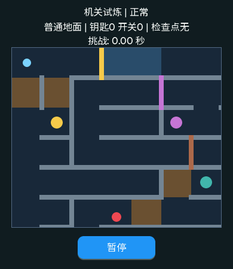

# 第4阶段：基础机关与正式第四关

版本`0.11.0-basic-mechanisms`。本轮一次接入粗糙地面、钥匙/开关/门、可破坏墙与检查点复活；前三关布局、钢珠手感和成绩保持。第四关“机关试炼”在第三关任一模式通关后解锁。若旧档已通第三关，升级后自动开放。

## 烧录

先确认本板实际串口，关闭串口监视器。若仍为COM6：

```powershell
Set-Location 'C:\Users\zytx\AppData\Local\Temp\huangshan-maze-gz9amdju\project\build_sf32lb52-lchspi-ulp_hcpu'
& 'D:\sifli\tools\tools\sftool\0.2.5\sftool.exe' -p COM6 -c SF32LB52 -m nor write_flash 'bootloader\bootloader.bin@0x12010000' 'main.bin@0x12020000' 'ftab\ftab.bin@0x12000000'
```

main.bin621308B，SHA-256 `b3b61b922562680c1fb08c94c7c485beca106a4be5485e964b9312809d9d9e5d`，[完整构建](../../evidence/builds/2026-11-02-stage4-01/README.md)。不要清档或整片擦除。

**旧v1/v2会在菜单自动迁移到四关v3，原成绩保留。成功保存v3后，0.10.x及更旧正式固件不能读取它，会报存档不可用。**本版不保存正在游玩的机关快照到Flash，重启从关卡开始。

## 玩法

- 普通与冰面不变；褐色粗糙区域阻力更大，放平更快停，进入时不会瞬间清速。
- 金黄色圆点是钥匙，拿到后同色门打开，钥匙不消耗。
- 紫色圆点是开关，碰到后锁存，同色门打开；离开开关不会关门。
- 棕色墙需要沿直线加速、正面快速撞击，慢碰或擦边不会破；破后可通过。
- 青绿色圆点是检查点，激活后变绿并有白边。它保存当时的钥匙/开关/破墙状态。
- 落坑后点“复活”，回检查点、恢复那份状态、清速度；放稳重新校准后继续，挑战时间和失误累计。点“重玩”则回原起点、全部机关复位，当前挑战的用时/失误仍累计。通关后再重玩开启新挑战。
- 暂停和设备错误恢复不清机关；返回选关结束挑战。取消校准回准备，沿用原累计规则，不能用取消抹掉失误。



## 一批完成本阶段新增短测

1. 启动应为`v0.11.0-basic-mechanisms`，四入口能显示；查看旧三关的成绩/累计失误和解锁是否保留，成绩页可循环四关。未通第三时第四锁定正常，先通第三任一模式再进第四。
2. 第四关开始并放稳校准：先往左侧下方支路拿金钥，回上方主路过金门；再绕右侧支路压紫开关，回紫门处通过。未取对应物时门应真正挡球，取后图形和碰撞一起消失。
3. 在下方较长直道对棕墙试一次慢撞，再沿直道加速正撞，确认慢撞不破、快撞能破并穿过。体验普通/冰/褐色粗糙地面阻力差异。
4. 激活青绿色检查点后落坑一次，确认失误只加1；点复活，放稳校准后从检查点继续，之前已开门/破墙仍保留，用时不倒退。暂停/继续一次；随后重玩，确认回起点、钥匙/门/墙/检查点全复位，当前挑战时间与失误仍累计。
5. 最后完成一轮通关，看本关成绩/失误和最终关无“下一关”；等保存结束后重启确认四关解锁/成绩保持。反转模式可在菜单切换，成绩独立。
6. 最后在准备页或选关页执行一次`free`、`ps`，贴输出和`[maze_store]`、`[maze_map]`、含`physics_gap_tick`/`keys`/`switches`/`broken`/`checkpoint`的几行`[maze]`。若闪球/黑块或报错保留前后日志，不调大100ms限制。

这是本阶段一次新增验收，不恢复旧B/C。构建、主机、受控中断和离屏已通过；上述真机手感、实际时序和堆栈仍待你操作反馈。没有自动烧录、提交或推送。

2026-11-02用户实测反馈“暂时没什么问题”，本轮总体正常，见[归档](../../evidence/ui/2026-11-02-stage4-board-01/README.md)。未提供的量化输出保留待证，无需重复已反馈的整批观察。
