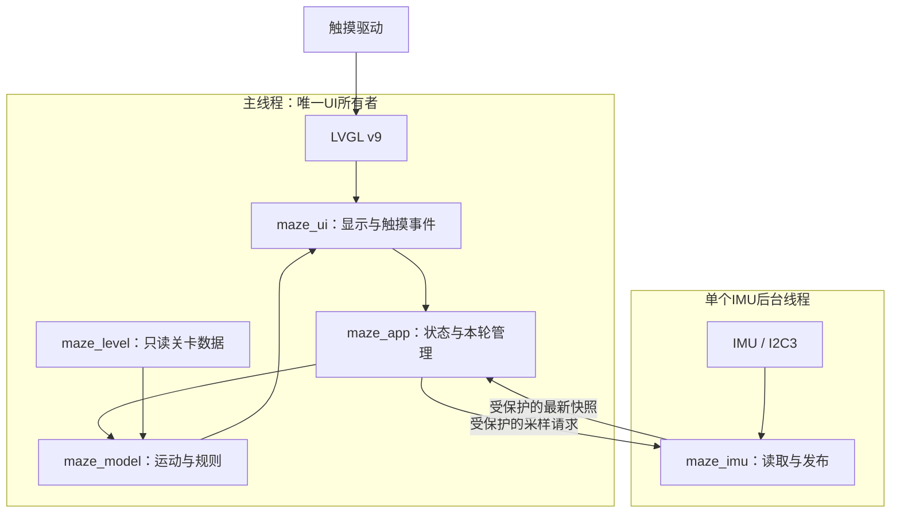
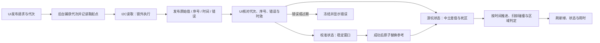
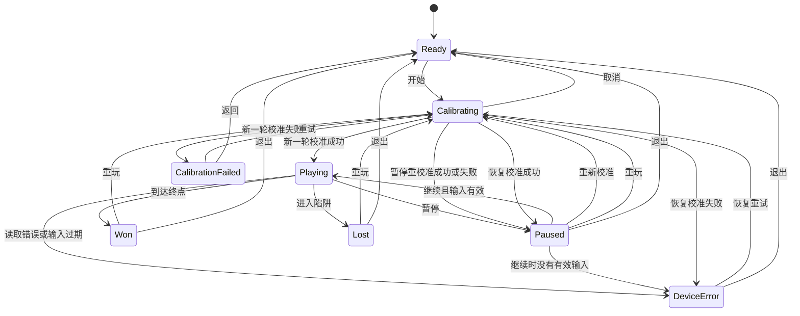

# 体感迷宫架构设计

日期：2026-10-17。状态：用户已审阅并认可书面设计；尚未实施。参数仍按候选性质管理。

## 1. 目的、依据与范围

依据[课程清单](../../course-requirements.md)、[产品需求 v0.2](../../product-requirements.md)、[验收计划](../../acceptance-test-plan.md)。目标是在真实黄山派上完成开始、校准、移动、碰撞、陷阱失败或到达终点、暂停、重玩的闭环，并留下可复核证据。

用户同意：关卡数据与游戏规则分开，第一版仍实现一个固定关卡。未来多关卡共用同一模型与线程；本轮不新增选关、自动下一关、解锁或成绩存储，不改变必达范围。增加多个可玩关卡时另补需求、切关规则与测试。

现状是RGB与串口IMU诊断，尚无迷宫或LVGL应用界面。本文新增模块名、字段名均为设计提议，不是已有接口。现有代码入口见 `src/main.c`、`src/imu_probe.c`；平台依据见[接口核对](../../research/platform-interface-audit.md)、[显示资源核对](../../research/display-resource-audit.md)、[IMU预研](../../research/imu-probe-results.md)。课程清单部分进度文字仍是早期快照；当前范围按已确认PRD解释，不把旧“待确定”文字当作重新撤销确认。

## 2. 方案取舍与系统架构图

选择“UI主线程＋一个IMU后台线程”。单线程直接读取I2C会阻塞触摸与绘图；另为物理、校准、每轮游戏创建线程会增加同步和回收负担。两线程让耗时I/O离开UI，状态、规则和绘图保留单一所有者。

拟定文件职责：

| 文件 | 责任与依赖 |
|---|---|
| `src/main.c` | 初始化应用并运行UI循环；替换原RGB阻塞循环时显式记录行为变化 |
| `src/maze_app.c/.h` | 状态、事件、校准窗口、本轮编号、有效时间累计；调用模型与采样接口 |
| `src/maze_model.c/.h` | 仅处理关卡、坐标、输入与经过时间；不依赖RT-Thread或LVGL，可主机测试 |
| `src/maze_level.c/.h` | 第一关只读常量和几何描述；不含UI对象或运行状态 |
| `src/maze_imu.c/.h` | 唯一应用IMU访问者、采样线程、请求与快照同步；不操作LVGL |
| `src/maze_ui.c/.h` | 页面、球与地图显示、按钮事件；不读取I2C，不独立决定胜败 |

不为每个墙体、按钮或每轮创建线程。后台线程启动一次，空闲等待请求。共享锁仅用于复制小型请求或快照；不持锁读I2C、等待、打印或调用LVGL。串口诊断与产品采样不得并发改写传感器寄存器：进入产品阶段时统一IMU所有权，保留历史诊断代码与证据，具体命令可用性在实现计划中明确。

## 3. 数据契约与数据流图

屏幕坐标右正、下正，位置/长度单位为像素，内部位置与速度保留小数；用时单位毫秒。用户2026-10-17确认后续屏幕朝上、USB在右侧，旧IMU实验朝向保持原记录。传感器原始三轴保留raw单位，不冒称角度。

| 数据 | 提议字段/含义 | 所有者 |
|---|---|---|
| 采样请求 | `generation`：操作代次；`enabled`：是否采样 | UI写，后台复制 |
| 最新快照 | `generation`、`sequence`、`read_start_tick`、`raw[3]`、`error` | 后台写，UI复制 |
| 校准候选 | 当前代次的20点窗口、起止时间、三轴极差、候选均值 | UI独有 |
| 本轮模型 | 关卡引用、球心、速度、有效用时、结果 | UI独有 |

`generation`在新开始、重玩、退出、每次校准尝试及恢复尝试时更新，失效快照同时清除。后台在开始一次读取前捕获请求代次；结果仍带该代次，不改贴成新代次。UI只接纳当前代次且序号未处理过的快照。代次表达异步操作生命周期，不当作可保存的成绩或关卡编号。

USB右映射使用 `screen_x = rawY - referenceY`、`screen_y = referenceX - rawX`。用户同意按同面朝上180°旋转对旧映射两轴取反，不重采四向日志；小球接入后检查实际方向，不将推导称为运动实测。逐轴死区内为0，超出部分扣除死区，避免阈值处突跳。采样序号未变化时不重复加入校准窗口；游玩可在有效时限内复用最近输入，过期立即停用并进入设备错误。

I/O阻塞不阻塞UI：退出立即使请求失效，不等待后台返回；后台当前读取结束后处理最新请求，停用时不发起下一次读取。SDK现有I2C调用可能阻塞约5000ms，不能把校准逻辑预算3秒解释为硬件调用3秒内返回。UI独立判超时并展示状态；新重试在旧读取未返回时也不接受其结果。若真机阻塞影响恢复体验，先核对实际SDK超时配置再调参，不假设可强制取消驱动。

## 4. 状态机与事件规则

校准保存来源：新一轮、暂停重校准、设备恢复；成功/失败去向按来源唯一决定，图中同名事件不得脱离来源判断。

| 场景 | 状态与数据处理 |
|---|---|
| 开始/重玩 | 清用时、速度、结果，从关卡起点准备；校准成功才进入游玩并计时，失败不开始 |
| 暂停/继续 | 暂停冻结位置与用时、清速度；继续用当前有效输入，不补算暂停时间；暂停期间后台保持采样 |
| 暂停重校准 | 保存旧参考；成功替换参考，失败保留旧参考，均保留球心/用时且回暂停；仍须明确继续 |
| 设备错误/恢复 | 冻结位置/用时、清速度，显示错误；重试成功更新参考后回暂停，失败仍设备错误 |
| 胜利/失败 | 仅从游玩结算一次，冻结结果与用时，停用采样；结果页倾斜不改变模型 |
| 退出/取消 | 失效旧请求，停用后续采样，清本轮回准备；迟到结果不触碰已离开的界面 |
| 重复或不适用事件 | 只执行当前状态允许的动作，不创建额外对象/线程、不叠加计时；外部未知命令返回明确错误 |

所有事件由UI线程串行处理；按钮回调只提交事件，不递归改变页面。每次主循环先处理已收到的操作和采样有效性，再推进当前游玩模型，最后更新界面。状态变化重新建立运动时基，防止跨暂停、校准或退出补算位移。

## 5. 关卡、运动与规则

关卡描述包含逻辑宽高、小球半径、起点、矩形墙数组、圆形陷阱数组、圆形终点。模型初始化接收只读关卡引用；视图按同一几何数据绘制，危险有效区和可见标记一致。第一版只有一份关卡常量，运行状态中不复制墙数组或创建关卡管理框架。

地图坐标使用游戏区域局部像素；UI统一加地图原点偏移，顶部状态/按钮不属于可通行地图。显示方向与触摸坐标先上板核对，再固定布局和地图尺寸。地图数据在主机测试中验证边界、起点可放球、区域互斥，以及考虑球半径后的可通行路线。

采用倾斜输入直接映射目标速度，避免先加入惯性参数。速度与死区后输入成比例，合成速度受上限约束，斜向不额外加速。运动按单调经过时间推进，显示只读取模型；显示20或40次/秒不改变物理时间。数值积分采用固定时间步与累计余量；大间隔拆步，不因绘图次数或循环次数决定速度。正常调度之外的超长停顿记录为时序错误并冻结，不静默丢弃时间继续游戏。

碰撞使用运动线段对“墙矩形按球半径外扩后的圆角区域”的最早接触，地图外边界同理；停止法向速度，保留切向位移以沿墙滑动。一次步进最多处理4次接触，仍有未解决接触则停留在最后安全位置、放弃该步余下位移，不穿墙。不能用普通方形外扩替代圆角几何，否则角部阻挡会与圆球不符。

每段实际可通行运动路径还检测球心与陷阱/终点区域的首次相交，包含边界，防止高速跨越小区域漏判；最早事件结算并停止剩余运动。地图保证危险区与终点不重叠。起始点也检查区域，具体边界由自动测试覆盖。不存在随机生成地图或运行时加载外部地图，内部常量由测试保证，产品不增加重复的运行时校验框架。

未来换关只替换关卡引用并重建本轮：失效旧操作、清模型、加载目标关卡、重新校准；不新增线程。切关入口与进度规则不在本版实现。

## 6. 参数、资源与分步准入

| 类别 | 当前依据 | 处理方式 |
|---|---|---|
| IMU候选 | 104Hz器件配置、约50ms采样间等待；20点/至少950ms稳定窗口、各轴极差≤300 raw、3秒逻辑预算、300 raw死区、100ms有效年龄与间隔 | 已有串口预研，不代表有UI负载时达标；显示启用后复测再纳入产品基线 |
| 新运动候选 | 固定步长10ms、合成速度上限120px/s、死区后输入幅值8192 raw达到上限；超长调度间隔阈值100ms | 本设计提出的试验起点，无实测；原型比较手感、窄通道及静置漂移后确认 |
| 显示候选 | 模型到UI更新50ms一次，LVGL事件循环持续服务 | 不用UI调用次数冒充真实屏幕帧率；沿用SDK已核对接入方式 |
| 当前资源事实 | 显示前堆total466100 B、used8980 B、历史峰值74252 B；主线程栈2048 B，报告峰值33% | 单次诊断记录，不能外推UI可用容量或无泄漏 |
| 资源分配原则 | 关卡只读；一个模型、一个最新快照、20点窗口；固定后台线程；UI对象按页面集中管理 | 不逐帧分配、不逐轮创建线程；离页后对象释放且不保留悬空引用 |
| 首次UI资源门槛 | 启用LVGL后记录真实缓冲配置/位置/大小、固件容量、堆和两个应用线程栈峰值 | 在创建完整地图前完成；资源不足先调整缓冲配置，不凭理论全屏数组大小判定容量 |

参数确认方式：保留相同版本和条件下的原始记录，更新需求/测试基线后才开展正式性能验收。显示与主机原型可以用于确定参数，不提前标记产品需求已完成。

## 7. 验证与成功标准

| 覆盖内容 | 对应需求与验收 | 本阶段/后续证据 |
|---|---|---|
| 准备、校准、取消、失败重试 | REQ-001/002；TC-001–003 | 主机状态序列＋板端校准反馈 |
| 映射、死区、时效、错误恢复 | REQ-003/008/011；TC-004/005/011/014 | 纯逻辑边界＋真实四向运动；注入错误单独标注 |
| 墙、角、滑动、高速扫掠与区域边界 | REQ-004–006；TC-006–009 | 可重复几何输入断言＋板端闭环视频 |
| 暂停、重玩、退出、迟到采样、连点 | REQ-007/009/010/013/014；TC-010/012/013/015/019 | 代次/事件序列测试＋重复板端操作 |
| 用时、显示独立、可见响应 | REQ-012/015–018/020；TC-005/016/020–022 | 独立时钟/屏幕视频、同输入不同显示频率对照 |
| 对象、线程、堆栈与长时 | REQ-013/019；TC-017/018 | 同准备状态50轮记录、至少30分钟及完整日志 |

当前文档成功标准：三图、所有权、异步取消、状态去向、关卡边界和证据限制自洽，关联现有REQ/TC；通过 `scripts/check_project.py --history` 与差异检查。所有正式产品TC仍未执行。本轮不改固件、不构建、不烧录。

后续顺序：用户审阅本文→编写并审阅实现计划→显示/触摸与资源原型→采样及纯逻辑模型→完整交互闭环→参数确认与正式验收。Git按用户收工指令统一提交推送。
